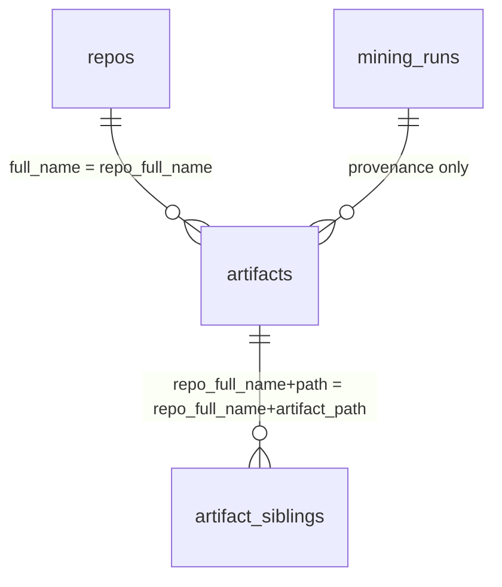
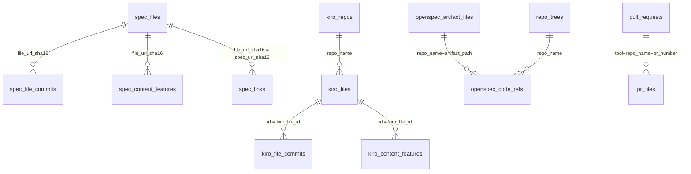
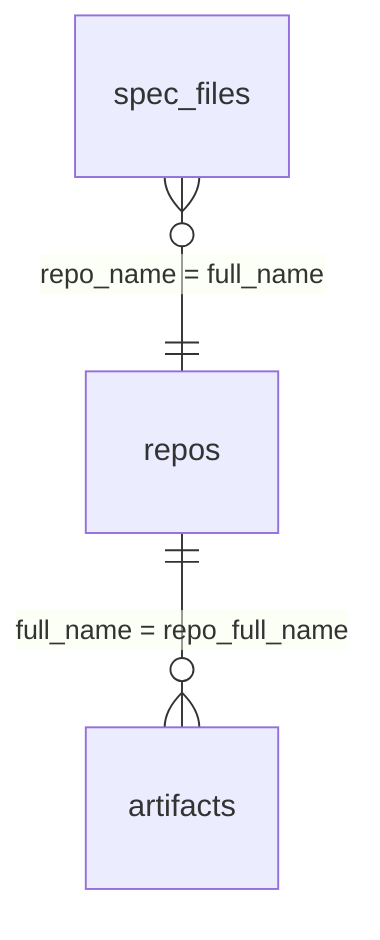

# MSR 2027 Mining Challenge — Data Model, ERD & Star Schema

This document inventories **every table and column** in the two challenge datasets
(**GitSkills** and **SpecMine**), explains how they relate to each other, and lays out
the **DuckDB star-schema design** used to cross them for analysis.

> **Sources inspected**
> - GitSkills: `gitskills-sample/agent_skills_sample/agent_skills_sample.db` (SQLite, sample)
> - SpecMine: `specmine-official/data/*.parquet` + `schema.sql` + `DATA_DICTIONARY.md` (v1.1 sample)
> - Hugging Face mirrors: `mvaccargiu/gitskills`, `ShyAgarwal/specmine`

---

## 1. Overview

Both datasets are **natural-language artifacts produced/consumed by AI coding agents**,
mined from public GitHub repositories in July 2026.

| | GitSkills | SpecMine |
|---|---|---|
| Artifact | `SKILL.md` (agent skills) | `spec.md` (spec-driven development) |
| Repo identifier | `repo_full_name` / `full_name` | `repo_name` |
| Native format | single SQLite file | Parquet (per table) + `specs.jsonl.gz` |
| Tables | 4 | 13 (v1.1 sample) / 10 (HF v1.0 mirror) |
| Full size | 41 GB SQLite | 1.6 GB Parquet |

**The key insight:** both datasets record the *same* GitHub repositories using the same
`owner/repo` slug. This single shared key is what lets us **join the two datasets** and
study co-adoption of agent skills and spec-driven development.

---

## 2. GitSkills — 4 tables

### 2.1 `artifacts` — one row per `SKILL.md` occurrence (FACT)

Sample: 29,786 rows · Full: 3,797,117 rows

| Column | Type | Meaning |
|---|---|---|
| `repo_full_name` | TEXT | `owner/repo` slug (PK part 1) |
| `path` | TEXT | file path within repo (PK part 2) |
| `filename` | TEXT | exact basename (case preserved) |
| `location_class` | TEXT | `canonical` / `skills-dir` / `other` |
| `file_sha` | TEXT | git blob hash (identical hash = identical bytes) |
| `discovered_at` | TEXT | when the collection run recorded the file |
| `content` | TEXT | full text (representatives only) |
| `content_fetched` | INTEGER | retrieval bookkeeping |
| `frontmatter_valid` | INTEGER | 1 if YAML front matter parses |
| `name` | TEXT | parsed front-matter name |
| `description` | TEXT | parsed front-matter description |
| `body_chars` | INTEGER | body length in characters |
| `history_fetched` | INTEGER | bookkeeping for history sample |
| `composition_fetched` | INTEGER | bookkeeping for folder composition |
| `dedup_primary` | INTEGER | 1 for the one representative per distinct content |
| `first_commit_at` | TEXT | first commit of the file (sampled rows) |
| `last_commit_at` | TEXT | last commit of the file (sampled rows) |
| `commit_count` | INTEGER | commits touching the file |
| `sibling_count` | INTEGER | bundled files in the skill folder |
| `sibling_bytes` | INTEGER | total bytes of bundled files |
| `has_scripts` | INTEGER | 1 if folder bundles scripts |
| `has_references` | INTEGER | 1 if folder bundles reference docs |
| `content_sha_ok` | INTEGER | 1 = hash verified, 2 = repaired via blob API |
| `composition_truncated` | INTEGER | 1 if folder exceeded listing cap |
| `first_commit_author` | TEXT | anonymised author code |
| `first_commit_author_type` | TEXT | `User` / `Bot` / `Organization` |
| `first_commit_message` | TEXT | commit message (emails/names masked) |
| `last_commit_author` | TEXT | anonymised author code |
| `last_commit_author_type` | TEXT | `User` / `Bot` / `Organization` |
| `last_commit_message` | TEXT | commit message (emails/names masked) |

### 2.2 `repos` — one row per repository (DIMENSION)

Sample: 11,841 rows · Full: 282,200 rows

| Column | Type | Meaning |
|---|---|---|
| `full_name` | TEXT | `owner/repo` slug (PK) |
| `owner` | TEXT | repository owner login |
| `stars` | INTEGER | star count |
| `forks` | INTEGER | fork count |
| `is_fork` | INTEGER | 1 if a fork |
| `language` | TEXT | primary language |
| `license` | TEXT | license name |
| `description` | TEXT | repo description (emails masked) |
| `created_at` | TEXT | repo creation timestamp |
| `pushed_at` | TEXT | last push timestamp |
| `metadata_fetched` | INTEGER | bookkeeping |

### 2.3 `artifact_siblings` — files bundled with a skill (FACT)

Sample: 47,829 rows · Full: 7,264,865 rows

| Column | Type | Meaning |
|---|---|---|
| `repo_full_name` | TEXT | `owner/repo` (FK part 1 → artifacts) |
| `artifact_path` | TEXT | skill path (FK part 2 → artifacts) |
| `entry_name` | TEXT | bundled file/dir name |
| `entry_type` | TEXT | `file` / `dir` |
| `entry_size` | INTEGER | size in bytes |
| `entry_sha` | TEXT | git blob hash |
| `content` | TEXT | text content (files up to 100 KB) |
| `content_fetched` | INTEGER | bookkeeping |
| `skipped_reason` | TEXT | binary / oversize / folder cap |

### 2.4 `mining_runs` — collection provenance (PROVENANCE)

7 rows

| Column | Type | Meaning |
|---|---|---|
| `run_id` | INTEGER | PK |
| `artifact_type` | TEXT | artifact type collected |
| `query` | TEXT | code-search query used |
| `started_at` | TEXT | run start |
| `finished_at` | TEXT | run end |
| `discovered` | INTEGER | result count |
| `note` | TEXT | free-form note |

---

## 3. SpecMine — 13 tables (v1.1 sample)

> **Version note:** the Hugging Face mirror is **v1.0 (10 tables)**. Your local sample is
> **v1.1 (13 tables)** — it adds `kiro_repos`, `kiro_file_commits`, `kiro_content_features`
> (the enriched Kiro layer). The 10 v1.0 tables are: `spec_files`, `spec_file_commits`,
> `spec_content_features`, `spec_links`, `kiro_files`, `openspec_artifact_files`,
> `openspec_code_refs`, `repo_trees`, `pull_requests`, `pr_files`.

### 3.1 `spec_files` — broad-census spine, one row per spec file (FACT)

Full: 470,795 rows · 124 columns. Raw Markdown is **not** in this table — it ships in
`specs.jsonl.gz`, joined on `file_url_sha16`.

**Identity & provenance**

| Column | Type | Meaning |
|---|---|---|
| `file_url_sha16` | char(16) | 16-hex digest of the blob URL (PK) |
| `file_url` | text | GitHub blob URL |
| `file_path` | text | path within repo |
| `file_name` | varchar(255) | file name |
| `file_sha` | varchar(64) | git blob hash |
| `git_url` | text | git blob API URL |
| `search_run_id` | varchar(64) | collection run id |

**Repository object (embedded dimension)**

| Column | Type | Meaning |
|---|---|---|
| `repo_id` | bigint | GitHub repo id |
| `repo_node_id` | varchar(255) | GraphQL node id |
| `repo_name` | varchar(511) | `owner/repo` slug (join key) |
| `repo_url` | text | repo URL |
| `repo_homepage` | text | homepage |
| `repo_description` | text | description |
| `repo_fork` | tinyint | 1 if fork |
| `repo_private` | tinyint | 1 if private |
| `repo_visibility` | varchar(32) | visibility |
| `owner_login` | varchar(255) | owner login |
| `owner_id` | bigint | owner id |
| `owner_node_id` | varchar(255) | owner node id |
| `owner_type` | varchar(64) | `User` / `Organization` |
| `owner_html_url` | text | owner URL |
| `owner_site_admin` | tinyint | site admin flag |
| `repo_stars` | int | star count |
| `repo_forks` | int | fork count |
| `repo_watchers` | int | watchers |
| `repo_subscribers_count` | int | subscribers |
| `repo_network_count` | int | network count |
| `repo_open_issues` | int | open issues |
| `repo_size_kb` | int | size in KB |
| `repo_language` | varchar(255) | primary language |
| `repo_license` | varchar(255) | license name |
| `repo_license_key` | varchar(128) | license key |
| `repo_license_spdx_id` | varchar(128) | SPDX id (NULL/NOASSERTION if none) |
| `repo_default_branch` | varchar(255) | default branch |
| `repo_topics` | text | topics |
| `repo_archived` | tinyint | archived flag |
| `repo_disabled` | tinyint | disabled flag |
| `repo_is_template` | tinyint | template flag |
| `repo_allow_forking` | tinyint | allow forking |
| `repo_web_commit_signoff_required` | tinyint | signoff required |
| `repo_has_issues` | tinyint | has issues |
| `repo_has_projects` | tinyint | has projects |
| `repo_has_wiki` | tinyint | has wiki |
| `repo_has_pages` | tinyint | has pages |
| `repo_has_downloads` | tinyint | has downloads |
| `repo_has_discussions` | tinyint | has discussions |
| `repo_clone_url` | text | clone URL |
| `repo_ssh_url` | text | ssh URL |
| `repo_svn_url` | text | svn URL |
| `repo_git_url` | text | git URL |
| `repo_mirror_url` | text | mirror URL |
| `repo_created_at` | varchar(64) | created timestamp |
| `repo_updated_at` | varchar(64) | updated timestamp |
| `repo_pushed_at` | varchar(64) | pushed timestamp |

**Last commit (file provenance)**

| Column | Type | Meaning |
|---|---|---|
| `file_last_commit_sha` | varchar(64) | last commit sha |
| `file_last_commit_node_id` | varchar(255) | node id |
| `file_last_commit_html_url` | text | commit URL |
| `file_last_commit_message` | longtext | commit message |
| `file_last_commit_comment_count` | int | comment count |
| `file_last_commit_at` | varchar(64) | last commit timestamp |
| `file_last_commit_author` | text | author name |
| `file_last_commit_author_login` | varchar(255) | author login |
| `file_last_commit_author_id` | bigint | author id |
| `file_last_commit_author_type` | varchar(64) | author type |
| `file_last_commit_author_html_url` | text | author URL |
| `file_last_commit_author_site_admin` | tinyint | site admin |
| `file_last_commit_committer` | text | committer name |
| `file_last_commit_committer_at` | varchar(64) | committer timestamp |
| `file_last_commit_committer_login` | varchar(255) | committer login |
| `file_last_commit_committer_id` | bigint | committer id |
| `file_last_commit_committer_type` | varchar(64) | committer type |
| `file_last_commit_committer_html_url` | text | committer URL |
| `file_last_commit_committer_site_admin` | tinyint | site admin |
| `file_last_commit_tree_sha` | varchar(64) | tree sha |
| `file_last_commit_parents` | text | parent shas |
| `file_last_commit_verified` | tinyint | verified flag |
| `file_last_commit_verification_reason` | varchar(64) | verification reason |
| `file_last_commit_verified_at` | varchar(64) | verified timestamp |
| `size_partition_label` | text | size partition |
| `updated_at` | timestamp | row update time |
| `not_spec_filter` | tinyint | 0 for kept specs (only kept rows ship) |

**First commit (adoption signal)**

| Column | Type | Meaning |
|---|---|---|
| `file_first_commit_sha` | varchar(64) | first commit sha |
| `file_first_commit_node_id` | varchar(255) | node id |
| `file_first_commit_html_url` | text | commit URL |
| `file_first_commit_message` | longtext | commit message |
| `file_first_commit_comment_count` | int | comment count |
| `file_first_commit_at` | varchar(64) | first commit timestamp (adoption signal) |
| `file_first_commit_author` | text | author name |
| `file_first_commit_author_login` | varchar(255) | author login |
| `file_first_commit_author_id` | bigint | author id |
| `file_first_commit_author_type` | varchar(64) | author type |
| `file_first_commit_author_html_url` | text | author URL |
| `file_first_commit_author_site_admin` | tinyint | site admin |
| `file_first_commit_committer` | text | committer name |
| `file_first_commit_committer_at` | varchar(64) | committer timestamp |
| `file_first_commit_committer_login` | varchar(255) | committer login |
| `file_first_commit_committer_id` | bigint | committer id |
| `file_first_commit_committer_type` | varchar(64) | committer type |
| `file_first_commit_committer_html_url` | text | committer URL |
| `file_first_commit_committer_site_admin` | tinyint | site admin |
| `file_first_commit_tree_sha` | varchar(64) | tree sha |
| `file_first_commit_parents` | text | parent shas |
| `file_first_commit_verified` | tinyint | verified flag |
| `file_first_commit_verification_reason` | varchar(64) | verification reason |
| `file_first_commit_verified_at` | varchar(64) | verified timestamp |
| `file_total_commits` | int | commits touching this artifact |
| `commit_history_status` | varchar(16) | done / empty / error / truncated |
| `commit_history_fetched_at` | varchar(32) | fetch timestamp |

**Attribution & trace roll-ups**

| Column | Type | Meaning |
|---|---|---|
| `spec_tool` | varchar(32) | attributed SDD tool / path bucket |
| `spec_role` | varchar(24) | living / change_proposal / archived / feature / config / na |
| `file_content_sha` | char(64) | sha256 of fetched content (dedup key) |
| `file_content_bytes` | int | content size |
| `content_fetch_status` | varchar(16) | done / missing / toobig / error |
| `content_fetched_at` | varchar(32) | fetch timestamp |
| `feature_branch` | varchar(255) | `Feature Branch:` header value |
| `n_linked_prs` | int | rolled-up PR references |
| `n_linked_issues` | int | rolled-up issue references |
| `n_sibling_docs` | int | rolled-up sibling-doc references |
| `n_code_links` | int | rolled-up code-file references |
| `has_tasks` | tinyint | has associated tasks.md |
| `has_plan` | tinyint | has plan.md |
| `has_proposal` | tinyint | has proposal.md |
| `has_design` | tinyint | has design.md |
| `trace_rollup_at` | varchar(32) | rollup timestamp |

### 3.2 `spec_file_commits` — per-file commit history (FACT)

Full: 780,335 rows · 24 columns

| Column | Type | Meaning |
|---|---|---|
| `id` | bigint | PK |
| `file_url_sha16` | char(16) | FK → spec_files |
| `repo_name` | varchar(512) | `owner/repo` slug |
| `file_path` | text | path within repo |
| `seq_from_oldest` | int | commit order (1 = oldest) |
| `commit_sha` | varchar(64) | commit sha |
| `node_id` | varchar(255) | node id |
| `html_url` | text | commit URL |
| `message` | longtext | commit message |
| `comment_count` | int | comment count |
| `authored_at` | varchar(64) | author timestamp |
| `author_name` | text | author name |
| `author_login` | varchar(255) | author login |
| `author_id` | bigint | author id |
| `author_type` | varchar(64) | author type |
| `committed_at` | varchar(64) | committer timestamp |
| `committer_name` | text | committer name |
| `committer_login` | varchar(255) | committer login |
| `committer_id` | bigint | committer id |
| `committer_type` | varchar(64) | committer type |
| `tree_sha` | varchar(64) | tree sha |
| `parents` | text | parent shas |
| `verified` | tinyint | verified flag |
| `verification_reason` | varchar(64) | verification reason |

### 3.3 `spec_content_features` — 39 structural features per spec (FACT-DIM)

Full: 468,307 rows · 40 columns (key + 39 features)

| Column | Type | Meaning |
|---|---|---|
| `file_url_sha16` | char(16) | FK → spec_files |
| `n_bytes` | int | size in bytes |
| `n_lines` | int | line count |
| `n_words` | int | word count |
| `n_headings` | int | heading count |
| `max_heading_depth` | int | deepest heading level |
| `n_code_fences` | int | code fence count |
| `n_mermaid` | int | mermaid diagram count |
| `n_tables` | int | table count |
| `n_links` | int | link count |
| `n_images` | int | image count |
| `n_list_items` | int | list item count |
| `n_checkboxes` | int | checkbox count |
| `n_checked` | int | checked checkbox count |
| `n_shall` | int | "shall" occurrences (EARS) |
| `n_gherkin` | int | Gherkin keyword count |
| `n_scenario_blocks` | int | scenario block count |
| `n_delta_headers` | int | delta header count |
| `n_needs_clarification` | int | clarification markers |
| `n_todo` | int | TODO markers |
| `has_ears` | tinyint | uses EARS syntax |
| `has_gherkin` | tinyint | uses Gherkin |
| `has_user_story` | tinyint | has user story |
| `has_requirements` | tinyint | has requirements section |
| `has_acceptance_criteria` | tinyint | has acceptance criteria |
| `has_user_scenarios` | tinyint | has user scenarios |
| `has_non_goals` | tinyint | has non-goals |
| `has_out_of_scope` | tinyint | has out-of-scope |
| `has_overview` | tinyint | has overview |
| `has_success_criteria` | tinyint | has success criteria |
| `has_edge_cases` | tinyint | has edge cases |
| `has_open_questions` | tinyint | has open questions |
| `has_dependencies` | tinyint | has dependencies |
| `has_purpose` | tinyint | has purpose |
| `has_mandatory_marker` | tinyint | has mandatory marker |
| `is_tiny` | tinyint | tiny spec flag |
| `has_unfilled_placeholder` | tinyint | unfilled placeholder |
| `has_lorem` | tinyint | lorem ipsum |
| `lang` | varchar(8) | detected language |
| `content_family` | varchar(24) | content family |

### 3.4 `spec_links` — traceability index, typed spec→code refs (FACT)

Full: 2,421,323 rows · 5 columns

| Column | Type | Meaning |
|---|---|---|
| `id` | bigint | PK |
| `spec_url_sha16` | char(16) | FK → spec_files |
| `rel` | varchar(16) | reference type |
| `target` | varchar(500) | referenced target |
| `provenance` | varchar(24) | how the ref was detected |

### 3.5 `kiro_files` — Kiro requirements/design/tasks (FACT)

Full: 98,574 rows · 18 columns

| Column | Type | Meaning |
|---|---|---|
| `id` | bigint | PK |
| `repo_name` | varchar(511) | `owner/repo` slug |
| `owner_login` | varchar(255) | owner login |
| `repo_id` | bigint | GitHub repo id |
| `file_path` | varchar(1000) | path within repo |
| `file_name` | varchar(255) | file name |
| `kind` | varchar(16) | requirements / design / tasks |
| `feature` | varchar(400) | feature name |
| `file_sha` | varchar(64) | git blob hash |
| `html_url` | text | blob URL |
| `git_url` | text | git blob API URL |
| `fetched_at` | varchar(32) | fetch timestamp |
| `file_content_sha` | char(64) | sha256 of content |
| `file_content_bytes` | int | content size |
| `content_fetch_status` | varchar(16) | fetch status |
| `file_total_commits` | int | commit count |
| `commit_history_status` | varchar(16) | history status |

### 3.6 `kiro_repos` — Kiro repository objects (DIMENSION, v1.1)

Full: 12,910 rows · 30 columns

| Column | Type | Meaning |
|---|---|---|
| `repo_name` | varchar(511) | `owner/repo` slug (PK) |
| `repo_id` | bigint | GitHub repo id |
| `repo_node_id` | varchar(255) | node id |
| `repo_url` | text | repo URL |
| `repo_homepage` | text | homepage |
| `repo_description` | text | description |
| `repo_fork` | tinyint | 1 if fork |
| `repo_visibility` | varchar(32) | visibility |
| `owner_login` | varchar(255) | owner login |
| `owner_id` | bigint | owner id |
| `owner_type` | varchar(64) | owner type |
| `repo_stars` | int | star count |
| `repo_forks` | int | fork count |
| `repo_watchers` | int | watchers |
| `repo_open_issues` | int | open issues |
| `repo_size_kb` | int | size in KB |
| `repo_language` | varchar(128) | primary language |
| `repo_license_key` | varchar(64) | license key |
| `repo_license_spdx_id` | varchar(64) | SPDX id |
| `repo_default_branch` | varchar(255) | default branch |
| `repo_topics` | text | topics |
| `repo_archived` | tinyint | archived flag |
| `repo_disabled` | tinyint | disabled flag |
| `repo_is_template` | tinyint | template flag |
| `repo_created_at` | varchar(64) | created timestamp |
| `repo_updated_at` | varchar(64) | updated timestamp |
| `repo_pushed_at` | varchar(64) | pushed timestamp |
| `fetch_status` | varchar(16) | fetch status |
| `fetched_at` | varchar(64) | fetch timestamp |

### 3.7 `kiro_file_commits` — Kiro per-artifact commit history (FACT, v1.1)

16 columns

| Column | Type | Meaning |
|---|---|---|
| `id` | bigint | PK |
| `kiro_file_id` | bigint | FK → kiro_files.id |
| `repo_name` | varchar(511) | `owner/repo` slug |
| `file_path` | text | path within repo |
| `seq_from_oldest` | int | commit order |
| `commit_sha` | varchar(64) | commit sha |
| `authored_at` | varchar(64) | author timestamp |
| `author_name` | text | author name |
| `author_login` | varchar(255) | author login |
| `author_id` | bigint | author id |
| `committed_at` | varchar(64) | committer timestamp |
| `committer_name` | text | committer name |
| `committer_login` | varchar(255) | committer login |
| `committer_id` | bigint | committer id |
| `message` | longtext | commit message |
| `html_url` | text | commit URL |

### 3.8 `kiro_content_features` — 39 features over Kiro content (FACT-DIM, v1.1)

40 columns (key + 39 features). Same 39 feature columns as `spec_content_features`
(§3.3), keyed by `kiro_file_id` instead of `file_url_sha16`.

| Column | Type | Meaning |
|---|---|---|
| `kiro_file_id` | bigint | FK → kiro_files.id |
| `n_bytes` … `content_family` | — | identical 39 features as §3.3 |

### 3.9 `openspec_artifact_files` — OpenSpec proposals/designs/tasks (FACT)

Full: 266,230 rows · 12 columns

| Column | Type | Meaning |
|---|---|---|
| `id` | bigint | PK |
| `repo_name` | varchar(511) | `owner/repo` slug |
| `file_path` | varchar(700) | path within repo |
| `kind` | varchar(24) | proposal.md / design.md / tasks.md / … |
| `content` | longtext | raw Markdown |
| `content_sha` | char(64) | content hash |
| `n_bytes` | int | size in bytes |
| `n_tasks` | int | parsed task-list item count |
| `n_tasks_done` | int | checked task-list items |
| `n_code_refs` | int | code paths named in tasks.md |
| `fetch_status` | varchar(16) | fetch status |
| `fetched_at` | varchar(32) | fetch timestamp |

### 3.10 `openspec_code_refs` — OpenSpec task→code refs (FACT)

Full: 435,401 rows · 8 columns

| Column | Type | Meaning |
|---|---|---|
| `id` | bigint | PK |
| `repo_name` | varchar(511) | `owner/repo` slug |
| `artifact_path` | varchar(700) | OpenSpec artifact path |
| `code_path` | varchar(500) | code path named by a task |
| `task_done` | tinyint | 1 if the naming task was checked off |
| `anchor_sha` | char(40) | commit the tree was resolved against |
| `exists_at_anchor` | tinyint | 1 if code_path existed at anchor_sha |
| `resolved_path` | varchar(700) | matched tree path, if any |

### 3.11 `repo_trees` — git-tree metadata (DIMENSION)

Full: 73,030 rows · 5 columns

| Column | Type | Meaning |
|---|---|---|
| `repo_name` | varchar(511) | `owner/repo` slug (PK) |
| `status` | varchar(16) | fetch status |
| `n_entries` | int | entries in the git tree |
| `truncated` | tinyint | 1 if GitHub truncated the listing |
| `fetched_at` | varchar(32) | fetch timestamp |

### 3.12 `pull_requests` — spec-touching PRs (FACT)

Full: 5,992 rows · 25 columns. 11 per-tool tables unioned (10 non-empty) + `tool` column.

| Column | Type | Meaning |
|---|---|---|
| `tool` | varchar(16) | SDD tool (10 of 11 swept tools appear) |
| `id` | bigint | PR id |
| `repo_name` | varchar(511) | `owner/repo` slug |
| `pr_number` | int | PR number |
| `title` | text | PR title |
| `state` | varchar(12) | open / closed |
| `is_merged` | tinyint | 1 if merged |
| `merged_at` | varchar(32) | merge timestamp |
| `created_at` | varchar(32) | creation timestamp |
| `closed_at` | varchar(32) | close timestamp |
| `author_login` | varchar(255) | author login |
| `head_branch` | varchar(400) | source branch |
| `base_branch` | varchar(255) | target branch |
| `n_files` | int | files changed |
| `n_specdir_files` | int | spec-dir files changed |
| `n_spec_files` | int | spec files changed |
| `n_code_files` | int | code files changed |
| `n_md_files` | int | markdown files changed |
| `n_other_files` | int | other files changed |
| `additions` | int | lines added |
| `deletions` | int | lines removed |
| `files_status` | varchar(12) | files status |
| `touches_code` | tinyint | 1 if PR changes code outside spec dir (co-change signal) |
| `n_code_outside` | int | code files changed outside spec dir |
| `n_prs_in_repo` | int | total spec-touching PRs in repo |

### 3.13 `pr_files` — per-file PR changesets (FACT)

Full: 348,141 rows · 12 columns

| Column | Type | Meaning |
|---|---|---|
| `tool` | varchar(16) | SDD tool |
| `id` | bigint | PR id |
| `repo_name` | varchar(511) | `owner/repo` slug |
| `pr_number` | int | PR number |
| `file_path` | varchar(1000) | path within repo |
| `change_status` | varchar(12) | added / modified / removed |
| `additions` | int | lines added |
| `deletions` | int | lines removed |
| `is_specdir` | tinyint | 1 if under spec directory |
| `is_spec` | tinyint | 1 if the file is a spec |
| `is_code` | tinyint | 1 if the file is source code |
| `ext` | varchar(16) | file extension |

---

## 4. ERD — how the tables relate

### 4.1 GitSkills



- `artifacts.repo_full_name` → `repos.full_name` (many skills per repo)
- `artifact_siblings.(repo_full_name, artifact_path)` → `artifacts.(repo_full_name, path)`
- `mining_runs` is standalone provenance (no FK)

### 4.2 SpecMine



- `spec_files.file_url_sha16` is the **primary key** of the broad census; three tables hang off it.
- `kiro_files.id` is the Kiro census key; two tables hang off it.
- `pull_requests.(tool, repo_name, pr_number)` is the composite key for the PR layer.
- `repo_name` is the **universal join key** across every SpecMine table.

### 4.3 The cross-dataset bridge



Both datasets share the **same GitHub `owner/repo` slug**:

| Dataset | Column |
|---|---|
| GitSkills | `repos.full_name`, `artifacts.repo_full_name` |
| SpecMine | `spec_files.repo_name`, `kiro_files.repo_name`, `pull_requests.repo_name`, … |

This single key enables the **co-adoption** analysis (repos that adopt both skills and specs).

---

## 5. DuckDB star-schema design

### 5.1 Conformed dimensions (shared)

| Dimension | Source | Grain | Key |
|---|---|---|---|
| `dim_repo` | GitSkills `repos` ∪ SpecMine `spec_files` repo cols ∪ `kiro_repos` | one row per `owner/repo` | `repo_full_name` |
| `dim_owner` | `repos.owner` / `spec_files.owner_login` | one row per account | `owner_login` |
| `dim_time` | commit timestamps, `discovered_at`, `created_at` | one row per day | `date` |
| `dim_tool` | `spec_files.spec_tool` | one row per SDD tool | `tool` |
| `dim_language` | `repos.language` / `repo_language` | one row per language | `language` |

### 5.2 Fact tables

| Fact | Source table | Grain | Dimensions |
|---|---|---|---|
| `fact_skill` | `artifacts` | one row per `SKILL.md` occurrence | repo, owner, time, language |
| `fact_skill_sibling` | `artifact_siblings` | one row per bundled file | repo, skill |
| `fact_spec` | `spec_files` | one row per spec file | repo, owner, time, tool, language |
| `fact_spec_commit` | `spec_file_commits` | one row per commit | repo, spec, time, author |
| `fact_spec_link` | `spec_links` | one row per typed reference | repo, spec |
| `fact_pr` | `pull_requests` | one row per PR | repo, tool, time |
| `fact_pr_file` | `pr_files` | one row per changed file | repo, PR |
| `fact_kiro` | `kiro_files` | one row per Kiro artifact | repo, time |
| `fact_openspec` | `openspec_artifact_files` | one row per OpenSpec artifact | repo |

### 5.3 The co-adoption fact (sample)

A derived fact table that answers the cross-dataset question directly:

```
fact_repo_adoption
  repo_full_name        (PK, FK → dim_repo)
  has_skills            (0/1 — from GitSkills artifacts)
  n_skills              (count of SKILL.md occurrences)
  first_skill_at        (earliest skill commit)
  has_specs             (0/1 — from SpecMine spec_files)
  n_specs               (count of spec files)
  first_spec_at         (earliest spec commit)
  spec_tools            (list of SDD tools used)
  adoption_class        ('skills-only' | 'specs-only' | 'both' | 'neither')
```

Core research query sample:

```sql
SELECT adoption_class, COUNT(*) AS repos,
       AVG(stars) AS avg_stars, AVG(n_skills) AS avg_skills
FROM fact_repo_adoption
JOIN dim_repo USING (repo_full_name)
GROUP BY adoption_class;
```

### 5.4 Why DuckDB

1. Reads Parquet **and** SQLite directly — no ETL.
2. Columnar engine handles the 41 GB GitSkills data comfortably.
3. Cross-dataset joins (`fact_skill` ⋈ `fact_spec` on `repo_full_name`) in a single query.
4. Streamlit can sit on top for the local web view.

---

## 6. Join-key cheat sheet

| Relationship | Left key | Right key |
|---|---|---|
| skill → repo | `artifacts.repo_full_name` | `repos.full_name` |
| sibling → skill | `artifact_siblings.repo_full_name` + `artifact_path` | `artifacts.repo_full_name` + `path` |
| spec commit → spec | `spec_file_commits.file_url_sha16` | `spec_files.file_url_sha16` |
| spec features → spec | `spec_content_features.file_url_sha16` | `spec_files.file_url_sha16` |
| spec link → spec | `spec_links.spec_url_sha16` | `spec_files.file_url_sha16` |
| kiro commit → kiro | `kiro_file_commits.kiro_file_id` | `kiro_files.id` |
| kiro features → kiro | `kiro_content_features.kiro_file_id` | `kiro_files.id` |
| kiro file → kiro repo | `kiro_files.repo_name` | `kiro_repos.repo_name` |
| openspec ref → openspec | `openspec_code_refs.repo_name` + `artifact_path` | `openspec_artifact_files.repo_name` + `file_path` |
| pr file → pr | `pr_files.tool` + `repo_name` + `pr_number` | `pull_requests.tool` + `repo_name` + `pr_number` |
| **skill → spec (cross)** | `artifacts.repo_full_name` | `spec_files.repo_name` |
| **repo → spec (cross)** | `repos.full_name` | `spec_files.repo_name` |


